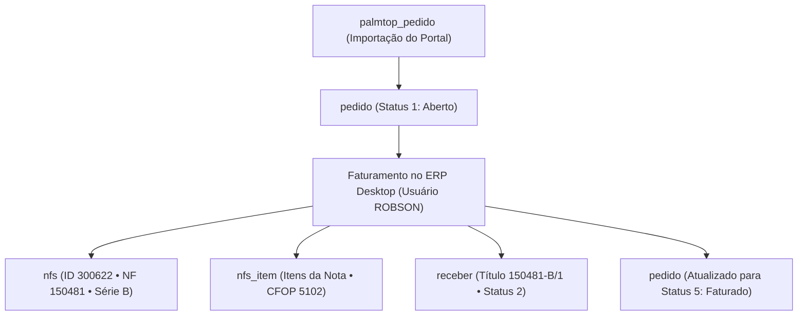

# Estudo Técnico & Rastreamento: Pipeline de Faturamento ERP & Módulo de Separação (E-commerce / AZ PETS CO)

- **Data da Análise:** 06/11/2026
- **Status:** **EM STAND-BY** (Aguardando autorização futura do usuário)
- **Cliente Alvo:** `16736 - AZ PETS CO` (CNPJ `22.876.867/0001-48`)

---

## 1. Rastreamento Real do Faturamento no ERP (Pedido Modelo: 160322)

A partir da auditoria no banco de dados PostgreSQL do ERP Nutricional, mapeamos a cadeia completa do pedido `160322` faturado em 06/11/2026 às 07:10:

### Detalhamento das Tabelas e Parâmetros:

1. **`pedido` e `pedido_item`:**
   - `idpedido`: `160322` | `idcliforemp`: `16736` | `idfilial`: `1`
   - `idtransacao`: `4` (`FILIAL 1 - PEDIDO INTERNO (SERIE 0)`)
   - `idserie`: `B` (`MATRIZ - NOTAS (SERIE 0)`)
   - `idcondicao`: `1002` (`AVISTA / PIX`) | `idmetodo`: `1000` (`PIX`)
   - `status`: Inicial `1` (Aberto) -> Atualizado para `5` (Faturado)
   - `valortotalpedido`: `297.36` -> `valortotalfaturado`: `297.36` (`valortotalsaldo`: `0.00`)
   - `aprovado_comercial`: `'S'` | `aprovado_financeiro`: `'S'`

2. **`nfs` (Nota Fiscal de Saída):**
   - `idnfs`: `300622` | `numeronf`: `150481` | `idserie`: `B`
   - `idtransacao`: `1003` (`FILIAL 1 - NOTAS INTERNO (SERIE 0)`)
     - *Origem da amarração:* `pedido_transacao.idtransacaonfs = 1003`
   - `pedidos`: `'Pedidos: (160322)'`
   - `idcfop`: `5102` | `valortotalnota`: `297.36`
   - **Achado Crucial de Arquitetura:**
     - A série `B` possui `gera_nf_eletronica = 'N'`. Não transmite para SEFAZ estadual (nota interna).
     - Porém, possui `exportaescritafiscal = 'S'` e gera mais de 90 colunas contábeis/fiscais (SPED/EFD, retenções, CBS/IBS, etc.).

3. **`receber` (Contas a Receber):**
   - `idreceber`: `527771` | `idnfs`: `300622`
   - `documento`: `'150481-B/1'`
   - `valororiginal`: `297.36` | `valorsaldo`: `297.36` | `status`: `2` (Aberto)

---

## 2. Conclusão Técnica sobre "Faturar Pedido" via Portal Web

- **Risco de Inconsistência:** O faturamento no ERP executa centenas de validações no binário desktop (lock de lote, sequência estrita de `numeronf`, integridade de custo e SPED). Fazer `INSERT` manual via PHP traz alto risco de quebra de numeração ou rejeição no fechamento fiscal.
- **Recomendação:** Deixar a emissão oficial da nota a cargo do ERP desktop (ou acionar robô/integrador de faturamento automático do ERP se configurado).

---

## 3. Arquitetura da Separação & Picking (Em Stand-by)

Quando o usuário autorizar a retomada, o fluxo desenhado consiste em:
1. **Notificação / Alerta:** Notificar o usuário com permissão quando houver pedidos da AZ PETS com `status = 1` pendentes de conferência.
2. **Aba de Separação (Picking):** Grade de itens com fotos, bipagem de código de barras ou conferência unitária.
3. **Histórico:** Gravação de log de conferência (usuário, data/hora e conferência de volumes) deixando o pedido pronto para faturamento rápido no ERP.
