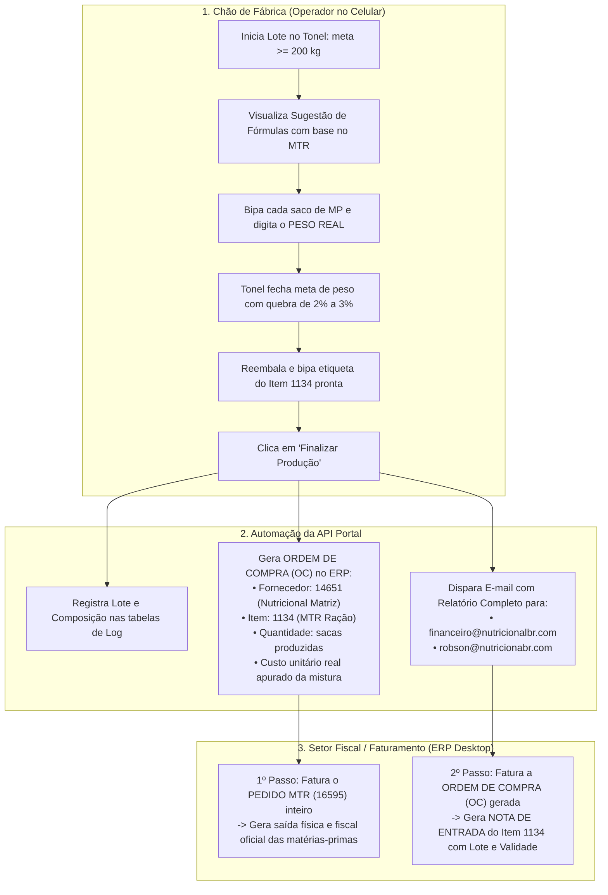

# Arquitetura e Especificação: Módulo Produção MTR ("Misturão")

> **Status:** Documentado / Em Espera (Aguardando conclusão das manutenções do Portal)  
> **Identificador de Continuidade:** `TOKEN-PRODUCAO-MTR-MISTURAO-20261021`  
> **Produto Acabado Alvo:** Item `1134` (`MTR RAÇÃO 20KG`), Código de Barras: `1000000011340`, Ref: `9998`  
> **Preço de Venda Definido (PV):** `R$ 99,90`  
> **Base de Matéria-Prima:** Estoque de Avarias / Retorno destinado ao cliente `16595` (`NUTRICIONAL MATERIA-PRIMA`)

---

## 1. Visão Geral do Processo

O processo consiste em reaproveitar produtos com embalagens avariadas ou mercadorias de retorno do cliente **MTR Matéria-Prima (`16595`)**, misturando-os em um tonel industrial (lotes a partir de **200 kg**), reembalando em sacas de **20 kg** (ou 18 kg) sob o código **Item 1134**, e precificando com base no custo gerencial apurado na mistura.

---

## 2. Regras de Negócio e Cálculos

### 2.1. Matéria-Prima e Ingredientes
- **Origem Exclusiva:** Itens presentes no pedido aberto (`status = 1`) do cliente `16595` (Estoque MTR).
- **Tipos Permitidos:** Sacos de ração de **1 kg a 15 kg** (cães, gatos e petiscos para dar o toque na mistura).
- **Aferição do Peso Real:** O operador bipa o código de barras do saco e **sempre informa o peso real da balança** (exemplo: saco de Monello Filhote cadastrado com 15 kg que chegou rasgado pesando apenas 13,2 kg).

### 2.2. Precificação, Custos e Margens
- **Preço de Venda do Item 1134:** **R$ 99,90**
- **Custo Utilizado:** **100% do Custo Gerencial** de cada matéria-prima consumida (sem dedução de 33%).
- **Lote e Perda de Processo:**
  - Tonel padrão de **200 kg** (lotes $\ge 200\text{ kg}$).
  - Quebra/Perda de processo estimada: **2% a 3%** (em poeira/fundo de tonel).
  - Exemplo: para envasar 10 sacas de 20 kg ($200\text{ kg}$), consome-se em média $205\text{ kg}$ de matéria-prima.
- **Cálculo do Custo Unitário do Produto Acabado:**
  $$\text{Custo Unitário da Saca 1134} = \frac{\sum (\text{Peso Real Consumido}_i \times \text{Custo Gerencial por Kg}_i)}{\text{Quantidade de Sacas 1134 Produzidas}}$$
  $$\text{Margem Bruta (\%)} = \frac{\text{R\$ } 99,90 - \text{Custo Unitário da Saca}}{\text{R\$ } 99,90} \times 100$$

### 2.3. Integridade do Estoque MTR no ERP
- **O Pedido MTR NUNCA tem itens excluídos/baixados pela API durante a produção.**
- O Pedido MTR permanece íntegro no banco de dados até o momento em que o faturista o **fatura diretamente pelo ERP Desktop**, garantindo a baixa contábil e fiscal das matérias-primas sem divergências.

---

## 3. Disparo de E-mail Executivo Automático

Ao finalizar a produção pelo celular, a API dispara via SMTP (`PHPMailer` autenticado em `mail.nutricionalbr.com`):

* **Destinatários:**
  - Para: `financeiro@nutricionalbr.com`
  - Com Cópia: `robson@nutricionabr.com`
* **Assunto:** `[PRODUÇÃO MTR] Relatório de Lote #XXXX - Item 1134 (MTR Ração)`
* **Conteúdo:**
  1. **Cabeçalho:** Número do lote, data/hora de fabricação, validade, operador responsável e OC gerada.
  2. **Balanço Físico:** Total kg matéria-prima despejada no tonel, peso líquido ensacado e % de quebra/perda.
  3. **Demonstrativo Financeiro:** Custo total da matéria-prima, custo médio por kg, custo apurado por saca, preço de venda (R$ 99,90), faturamento total previsto e margem de lucro bruta (%).
  4. **Grade de Rastreabilidade:** Relação detalhada de todos os itens despejados com pesos cadastrados vs. pesos reais de balança.
  5. **Checklist Operacional do ERP:**
     - `[ ]` 1. Faturar Pedido MTR `#159400` (saída de matéria-prima).
     - `[ ]` 2. Faturar Ordem de Compra `#XXXX` (entrada do Item 1134 no estoque).

---

## 4. Integração com o ERP (Tabelas e Estrutura Prevista)

Quando o módulo for implementado, as seguintes entidades serão utilizadas:

| Operação | Tabelas Envolvidas | Descrição |
|---|---|---|
| **Controle de Produção** | `producao_mtr_lote` `producao_mtr_item` `producao_mtr_saca` | Tabelas dedicadas para histórico, pesagem real e composição de cada tonel. |
| **Geração de Entrada** | `oc` `oc_item` `oc_transacao` | Criação da Ordem de Compra para o fornecedor `14651` (*Nutricional Distribuidora Matriz*), item `1134`, com custo unitário apurado. |
| **Rastreio de Lote** | `lote` | Registro do número de lote, fabricação e validade para associação no faturamento da entrada. |

---

## 5. Token de Continuidade

Para retomar o desenvolvimento deste módulo após a conclusão das manutenções, referencie:

> **TOKEN DE RETOMADA:** `TOKEN-PRODUCAO-MTR-MISTURAO-20261021`  
> **Arquivo de Especificação:** `docs/modulo_producao_mtr_especificacao.md`

