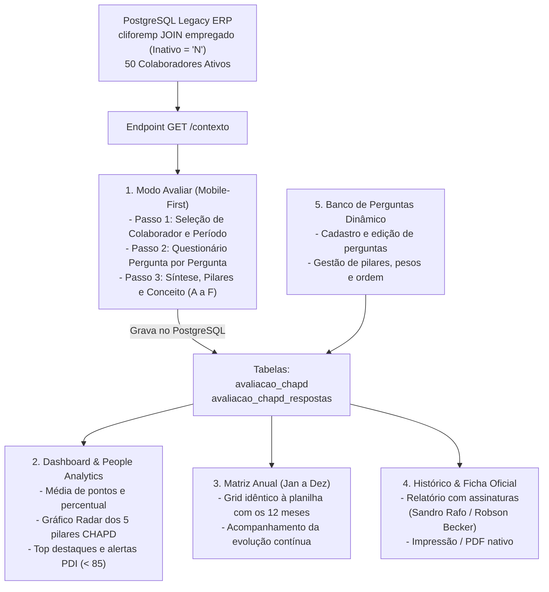

# Módulo de Avaliação de Desempenho C.H.A.P.D

**Identificador Único:** `MOD-AVALIACAO-CHAPD`  
**Arquivos de Código:**
- Frontend: `portal/modules/avaliacao-chapd.php` e `portal/assets/js/avaliacao-chapd.js`
- Backend: `v1/src/Controllers/AvaliacaoChapdController.php`
- Rotas API: `v1/routes/api.php` (`/v1/avaliacao-chapd/...`)
- Banco de Dados: Tabelas `avaliacao_chapd`, `avaliacao_chapd_perguntas`, `avaliacao_chapd_respostas` e registro em `sistema_modulos` (`slug = 'avaliacao-chapd'`)
**Última Atualização:** 30/10/2026  
**Responsável Técnico:** Tech Lead & Especialista em People Analytics

---

## 1. Objetivo do Módulo

O módulo **Avaliação de Desempenho C.H.A.P.D** digitaliza, aprimora e expande a metodologia de avaliação contínua da **Nutricional Distribuidora**, originalmente mantida em planilha pelo setor de Recursos Humanos e Diretoria.

O acrônimo **C.H.A.P.D** sintetiza as 5 dimensões de competência avaliadas:
* **C — Conhecimento:** Domínio de procedimentos, normas internas e reflexão crítica.
* **H — Habilidade:** Qualidade técnica, precisão e foco em metas.
* **A — Atitude:** Proatividade, entusiasmo, senso de dono e dinamismo frente a desafios.
* **P — Postura:** Trabalho em equipe, cooperação, inteligência emocional e limites hierárquicos.
* **D — Disciplina:** Cumprimento da jornada/horários, zelo pelo patrimônio e adesão aos projetos da empresa.

---

## 2. Arquitetura do Sistema e Fluxo de Uso



---

## 3. Critérios de Avaliação e Regras de Negócio

### 3.1 Escala de Pontuação por Pergunta
Cada pergunta recebe uma das seguintes 5 notas pré-definidas:
* **10 — SEMPRE:** Desempenho exemplar e consistente.
* **08 — FREQUENTEMENTE:** Atende aos requisitos na grande maioria das situações.
* **06 — ÀS VEZES:** Comportamento irregular ou que demanda supervisão.
* **04 — RARAMENTE OU QUASE NUNCA:** Dificuldade evidente em atender aos padrões.
* **02 — NUNCA:** Inexistente ou prejudicial às rotinas de trabalho.

### 3.2 Faixas Oficiais de Classificação (Máx. 140 Pontos nas 14 Perguntas Iniciais)
$$\text{Percentual} = \left(\frac{\text{Pontuação Total}}{\text{Pontuação Máxima}}\right) \times 100$$

* **> 125 Pontos:** `Excelente` *(Verde Esmeralda)* — Referência técnica e comportamental.
* **100 a 125 Pontos:** `Aceitável e com Potencial` *(Azul)* — Desempenho sólido e com boa capacidade de crescimento.
* **85 a 99 Pontos:** `Médio Potencial / Em Observação` *(Amarelo)* — Atende às rotinas básicas, mas necessita de estímulo.
* **< 85 Pontos:** `Baixo Potencial / Atenção Crítica` *(Vermelho / Rose)* — Exige intervenção com Plano de Desenvolvimento Individual (PDI).

### 3.3 Conceitos por Letras (Características do Perfil)
* **Grupo 1 — Características construtivas (Diferencial):**
  * **A:** Altamente engajado e competente nas metas e tarefas.
  * **B:** Excelente desempenho, busca aperfeiçoamento e assume responsabilidades.
* **Grupo 2 — Características com potencial de desenvolvimento:**
  * **C:** Médio potencial, falta desenvolver proatividade mas mostra-se disposto ao crescimento.
  * **D:** Limita-se às tarefas de rotinas, mas busca atender às expectativas em novos desafios.
* **Grupo 3 — Características que não agregam valor:**
  * **E:** Baixo desempenho, tomadas de decisões e aperfeiçoamento não fazem parte do perfil.
  * **F:** Baixo desempenho, falta dinamismo e proatividade.

---

## 4. Estrutura do Banco de Dados (PostgreSQL)

### 4.1 Tabela `avaliacao_chapd_perguntas`
Armazena o banco de perguntas dinâmicas (inicializado com as 14 perguntas originais da planilha):
```sql
CREATE TABLE avaliacao_chapd_perguntas (
    id SERIAL PRIMARY KEY,
    codigo VARCHAR(20) NOT NULL,
    pilar VARCHAR(20) NOT NULL, -- 'C', 'H', 'A', 'P', 'D'
    pergunta TEXT NOT NULL,
    descricao_auxiliar TEXT,
    peso NUMERIC(5,2) DEFAULT 1.0,
    ordem INTEGER NOT NULL DEFAULT 1,
    ativo BOOLEAN NOT NULL DEFAULT TRUE,
    criado_em TIMESTAMP DEFAULT CURRENT_TIMESTAMP,
    atualizado_em TIMESTAMP DEFAULT CURRENT_TIMESTAMP
);
```

### 4.2 Tabela `avaliacao_chapd`
Cabeçalho de cada avaliação efetuada:
```sql
CREATE TABLE avaliacao_chapd (
    id SERIAL PRIMARY KEY,
    idcliforemp INTEGER NOT NULL,
    nome_colaborador VARCHAR(180) NOT NULL,
    cargo VARCHAR(120),
    idfilial INTEGER,
    setor VARCHAR(100),
    celula_trabalho VARCHAR(120),
    ano INTEGER NOT NULL,
    mes INTEGER NOT NULL, -- 1 a 12
    data_avaliacao DATE NOT NULL DEFAULT CURRENT_DATE,
    avaliador_nome VARCHAR(120) NOT NULL,
    avaliador_usuario VARCHAR(80),
    aprovador_nome VARCHAR(120),
    pontuacao_total NUMERIC(6,2) NOT NULL DEFAULT 0,
    pontuacao_maxima NUMERIC(6,2) NOT NULL DEFAULT 140,
    percentual_atingido NUMERIC(5,2) NOT NULL DEFAULT 0,
    classificacao_pontos VARCHAR(60),
    conceito_letra VARCHAR(10),
    conceito_descricao TEXT,
    pontos_conhecimento NUMERIC(6,2) DEFAULT 0,
    pontos_habilidade NUMERIC(6,2) DEFAULT 0,
    pontos_atitude NUMERIC(6,2) DEFAULT 0,
    pontos_postura NUMERIC(6,2) DEFAULT 0,
    pontos_disciplina NUMERIC(6,2) DEFAULT 0,
    pontos_fortes TEXT,
    pontos_desenvolver TEXT,
    plano_acao TEXT,
    observacoes_gerais TEXT,
    status VARCHAR(30) DEFAULT 'concluida',
    criado_em TIMESTAMP DEFAULT CURRENT_TIMESTAMP,
    atualizado_em TIMESTAMP DEFAULT CURRENT_TIMESTAMP,
    CONSTRAINT uk_chapd_colab_periodo UNIQUE (idcliforemp, ano, mes)
);
```

### 4.3 Tabela `avaliacao_chapd_respostas`
Respostas detalhadas de cada questão para auditoria e histórico:
```sql
CREATE TABLE avaliacao_chapd_respostas (
    id SERIAL PRIMARY KEY,
    idavaliacao INTEGER NOT NULL REFERENCES avaliacao_chapd(id) ON DELETE CASCADE,
    idpergunta INTEGER NOT NULL,
    pilar VARCHAR(20) NOT NULL,
    pontuacao NUMERIC(5,2) NOT NULL,
    texto_opcao VARCHAR(60),
    observacao_item TEXT,
    criado_em TIMESTAMP DEFAULT CURRENT_TIMESTAMP
);
```

---

## 5. Endpoints REST da API Slim 3

Base: `/v1/avaliacao-chapd` (protegido por JWT, CSRF e `ModulePermissionMiddleware('avaliacao-chapd')`)

| Método | Endpoint | Descrição |
| :--- | :--- | :--- |
| `GET` | `/v1/avaliacao-chapd/contexto` | Retorna 50 colaboradores ativos do ERP, 14 perguntas ativas, meses e escalas. |
| `GET` | `/v1/avaliacao-chapd/dashboard` | Indicadores de People Analytics (médias, radar, destaques e alertas). |
| `GET` | `/v1/avaliacao-chapd/matriz-anual` | Tabela consolidada com pontuações dos 12 meses (Jan a Dez) por colaborador. |
| `GET` | `/v1/avaliacao-chapd/historico` | Lista de avaliações finalizadas com filtros avançados. |
| `GET` | `/v1/avaliacao-chapd/detalhes/{id}` | Retorna a ficha completa com respostas detalhadas para impressão de PDF. |
| `POST` | `/v1/avaliacao-chapd/salvar` | Gravação atômica da avaliação com cálculo automático dos 5 pilares C.H.A.P.D. |
| `GET` | `/v1/avaliacao-chapd/perguntas` | Lista do banco de perguntas e critérios. |
| `POST` | `/v1/avaliacao-chapd/perguntas/salvar` | Cadastro ou alteração de critério de pergunta. |
| `POST` | `/v1/avaliacao-chapd/perguntas/toggle` | Ativação ou inativação de pergunta. |

---

## 6. Manual Operacional Passo a Passo

1. **Acessando o Módulo:**
   - No Portal, navegue até **Recursos Humanos** $\rightarrow$ **Avaliação C.H.A.P.D** (ou pela URL `/portal/modules/avaliacao-chapd.php`).
2. **Iniciando a Avaliação:**
   - Selecione o colaborador ativo no dropdown (o sistema preenche automaticamente o cargo, filial e sugere o setor).
   - Defina o mês e o ano de competência.
   - Clique em **"Iniciar Avaliação Pergunta por Pergunta"**.
3. **Respondendo no Celular ou Desktop:**
   - O sistema apresenta o enunciado em destaque e o pilar correspondente.
   - Toque em uma das 5 notas (`10 Sempre`, `08 Frequentemente`, `06 Às Vezes`, `04 Raramente`, `02 Nunca`).
   - O formulário avança automaticamente com animação suave e atualiza o progresso no topo.
4. **Fechamento e Síntese:**
   - Ao concluir a 14ª pergunta, a tela de fechamento exibe a pontuação apurada e o gráfico de desempenho dos 5 pilares.
   - Escolha o Conceito Letra (A a F) correspondente ao perfil demonstrado.
   - Preencha os Pontos Fortes, Oportunidades de Melhoria e o Plano de Ação (PDI).
   - Clique em **"Concluir e Salvar Avaliação"**.
5. **Emissão de Relatório / Impressão:**
   - Acesse a aba **Histórico & Fichas** ou a **Matriz Anual** e clique em **Ficha**.
   - A ficha oficial é aberta com visual idêntico à planilha da Nutricional, contendo os campos de assinatura de Elaboração (Sandro Rafo) e Aprovação (Robson Becker) e suporte a impressão direta em PDF.

