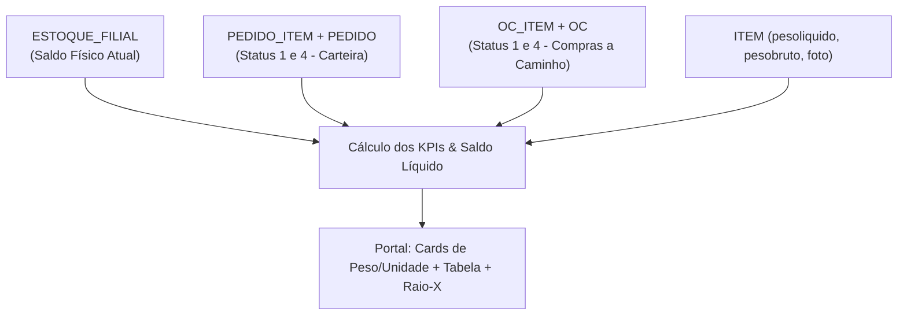

# Módulo de Estoque com Previsão de Chegada (Visão Unificada Matriz + Filial PR)

**Identificador Único:** `MOD-ESTOQUE-PREVISAO`  
**Arquivos de Código:**
- Frontend: `portal/modules/estoque-previsao.php` e `portal/assets/js/estoque-previsao.js`
- Backend: `v1/src/Controllers/EstoquePrevisaoController.php`
- Rotas API: `v1/routes/api.php` (`/v1/estoque-previsao/...`)
**Última Atualização:** 26/10/2026  
**Responsável Técnico:** Tech Lead & Arquiteto de Software

---

## 1. Objetivo do Módulo

O módulo **Estoque com Previsão de Chegada** é a central executiva de planejamento, suprimentos e logística da Nutricional. Ele consolida em tempo real o **Estoque Físico em Armazém**, a **Carteira de Pedidos de Venda Reservada** e as **Ordens de Compra (OCs) a Caminho**, permitindo que diretores, compradores, gestores comerciais e a equipe de logística tenham uma visão antecipada e precisa da disponibilidade de mercadorias.

### Principais Objetivos de Negócio:
1. **Previsibilidade Operacional:** Saber exatamente o que está livre para venda imediata e o que estará disponível nos próximos dias com a chegada de cargas da indústria.
2. **Visão em Tonelagem (Peso) e Unidades:** Análise voltada para logística pesada (caminhões, capacidade de pátio e tonelagem total em Toneladas / KG) e para separação de depósito (unidades/caixas).
3. **Visão Unificada Multi-Filial:** Possibilidade de auditar o ecossistema completo consolidado (Matriz 1 SC + Filial 6 PR) ou isolar filiais específicas com um único clique.
4. **Agilidade de Navegação:** Barra de filtros fixa na rolagem (`sticky`), permitindo pesquisar SKUs e trocar marcas mesmo ao navegar por centenas de produtos.

---

## 2. Estrutura e Origem dos Dados (Schema do ERP)

O módulo integra 4 grandes conjuntos de dados do PostgreSQL do ERP:

1. **Saldo Físico (`ESTOQUE_FILIAL`):**
   - Coluna: `ef.SALDOATUAL`
   - Unidades: Filial 1 (Matriz SC) e Filial 6 (Paraná PR).
   - Filtro de integridade: `i.INATIVO = 'N'` e `i.TIPO = '0'` (somente mercadorias de revenda ativas).

2. **Carteira Reservada (`PEDIDO_ITEM` + `PEDIDO`):**
   - Coluna: `COALESCE(pi.QTSALDO, pi.QT)`
   - Status dos Pedidos: `p.STATUS IN (1, 4)` (1 = Aberto / Digitação, 4 = Liberado / Aprovado).
   - Significado: Mercadorias vendidas e aguardando faturamento/separação.

3. **Previsão de Compras a Caminho (`OC_ITEM` + `OC`):**
   - Coluna: `SUM(oci.QTSALDO)`
   - Status da OC: `oc.STATUS IN ('1', '4')`, `oc.SITUACAO IN (2, 6)` e transação de compra mercantil (`oct.TIPO = 0`).
   - Significado: Pedidos de compra já emitidos para os fornecedores de ração (ex.: Nutrire, Quatree, etc.) que estão em transporte ou aguardando descarga.

4. **Peso dos Produtos (`ITEM`):**
   - Colunas: `i.PESOLIQUIDO` e `i.PESOBRUTO` (em KG).
   - Utilizado como multiplicador para converter peças e embalagens em **peso líquido total (KG e Toneladas)**.

---

## 3. Explicação Detalhada dos 6 Cards de KPI

A pedido da diretoria e supervisão, os cards contam com o seletor **Peso (KG / Ton)** vs **Unidades (Peças)**. A seguir, a memória de cálculo de cada indicador:

### Card 1: Estoque Físico
* **O que representa:** Tudo o que está fisicamente dentro dos almoxarifados da Matriz e do Paraná no momento da consulta.
* **Cálculo em Unidades:** $\sum \text{ef.SALDOATUAL}$
* **Cálculo em Peso:** $\sum (\text{ef.SALDOATUAL} \times \text{i.PESOLIQUIDO})$
* **Exemplo Real:** 177.020 unidades correspondendo a **801,6 Toneladas** (Matriz: 800,8 t · Filial PR: 0,8 t).

### Card 2: Reservado (Pedidos em Carteira)
* **O que representa:** O volume de produtos que já foi vendido pela equipe comercial, mas ainda não saiu do depósito (pedidos abertos ou aprovados).
* **Cálculo em Unidades:** $\sum \text{COALESCE(pi.QTSALDO, pi.QT)}$
* **Cálculo em Peso:** $\sum (\text{Qtd Reservada} \times \text{i.PESOLIQUIDO})$
* **Exemplo Real:** 13.707 unidades correspondendo a **92,5 Toneladas** empenhadas.

### Card 3: Livre Disponível (Venda Imediata)
* **O que representa:** O saldo real que a equipe de vendas tem para ofertar e faturar imediatamente sem risco de ruptura.
* **Fórmula Matemática:**
  $$\text{Estoque Livre} = \max(0, \, \text{Estoque Físico} - \text{Carteira Reservada})$$
* **Exemplo Real:** $177.020 - 13.707 = 163.313 \text{ un}$ ou **709,1 Toneladas livres**.

### Card 4: Previsão de Compras (A Caminho)
* **O que representa:** As ordens de compra emitidas para as fábricas parceiras com entrega prevista.
* **Por que aparecia com decimais quebrados antes (ex.: `187.483,44`)?**
  No ERP, determinadas matérias-primas e ordens de compra são lançadas de forma fracionada ou por peso em KG na coluna `QTSALDO`. 
* **A solução definitiva (Peso):** Traduzido para peso real, este número representa **870,7 Toneladas** de mercadorias a caminho distribuídas em **38 Ordens de Compra** abertas!

### Card 5: Estoque Futuro (Projeção Total)
* **O que representa:** A disponibilidade total que a distribuidora terá no curto prazo quando as compras a caminho forem descarregadas nos depósitos.
* **Fórmula Matemática:**
  $$\text{Estoque Futuro} = \text{Estoque Livre Disponível} + \text{Previsão de Compras}$$
* **Exemplo Real:** $709,1 \text{ t} + 870,7 \text{ t} =$ **1.579,8 Toneladas projetadas** ($350.796 \text{ unidades}$).

### Card 6: Críticos / Zerados
* **O que representa:** SKUs que exigem ação urgente do setor de compras.
  - **Zerados:** Saldo livre $\le 0$.
  - **Críticos:** Saldo livre entre 1 e 10 unidades.

---

## 4. Manual de Explicação para Gestores & Supervisão

### Cenário de Uso 1: Planejamento Logístico e Capacidade de Pátio
* **Pergunta do Supervisor:** *"Quantas toneladas de ração teremos chegando nesta semana e onde vamos armazenar?"*
* **Como responder pelo Portal:**
  1. No topo, selecione a filial desejada ou mantenha **Unificado**.
  2. Clique em **Peso (KG / Ton)** no seletor de métricas.
  3. Olhe o **Card 4 (Previsão Compras)**: ele exibe imediatamente a tonelagem exata (ex.: **870,7 t** em 38 carretas/OCs).
  4. Para ver quais dias e fornecedores entregarão primeiro, clique no filtro **Situação do Estoque** $\rightarrow$ **"Com Previsão de Chegada"** e consulte a coluna **A Chegar**.

### Cenário de Uso 2: Vendedor quer fechar um grande pedido de 500 sacos
* **Pergunta do Vendedor:** *"Posso fechar um pedido de 500 sacos de ração Bancat 25kg?"*
* **Como responder pelo Portal:**
  1. Digite `Bancat 25kg` no campo de busca textual (a barra fica sempre visível no topo da tela).
  2. Olhe a coluna **Livre**: se o valor livre for menor que 500 (ex.: livre 4), olhe a coluna **A Chegar (OCs)**.
  3. Clique na linha do produto: o **Raio-X do Produto** abrirá na tela exibindo a data exata em que o caminhão da fábrica deve descarregar a carga no depósito.

---

## 5. Perguntas e Respostas Frequentes (FAQ)

**P1: O que acontece se um pedido for cancelado no ERP?**  
*R:* O saldo reservado é liberado instantaneamente. Como a API consulta a tabela `PEDIDO` em tempo real com `STATUS IN (1, 4)`, pedidos cancelados (status 2) deixam de abater o saldo imediatamente.

**P2: O filtro sticky atrapalha a visualização em celulares?**  
*R:* Não. O sticky foi desenvolvido com `backdrop-blur` e sombra sutil, ocupando apenas o espaço estritamente necessário no topo da tela para garantir agilidade operacional em qualquer dispositivo.

**P3: Por que a visualização padrão inicial destaca o peso?**  
*R:* Porque no segmento de nutrição animal e distribuição pesada, decisões de frete, frete retorno, cubagem de carretas e armazenagem em porta-paletes são todas tomadas com base em **toneladas métricas**. Caso o usuário prefira ver em caixas/pacotes, basta clicar em **Unidades (Peças)** e o sistema salva sua preferência no navegador.

---

## 6. Histórico de Alterações e Ficha de Manutenção

| Data | Versão | Autor | Alteração Realizada |
| :--- | :---: | :---: | :--- |
| **26/10/2026** | `1.2.0` | Tech Lead | **Tooltips Modernos Globais (`#nutri-tooltip` via `data-tooltip`):** Balões escuros modernos com backdrop-blur substituindo o title nativo. **Cards Rastreáveis ao Clicar:** Clique direto em qualquer KPI filtra a tabela (Físico, Reservado, Livre, Previsão, Futuro, Críticos/Zerados) com feedback visual de anel verde e badge `[Filtrando]`. **Fixação da Barra de Filtros (`sticky top-3`) & Cabeçalho da Tabela (`thead sticky`):** Navegação fluida em grandes listas de produtos. **Métricas em Peso (KG/Ton):** Cálculo ponderado por `i.PESOLIQUIDO` e alternador Peso vs Unidades. |
| **20/10/2026** | `1.0.0` | Tech Lead | Criação inicial do módulo unificado Matriz + PR com filtros por marca, status e busca preditiva. |

