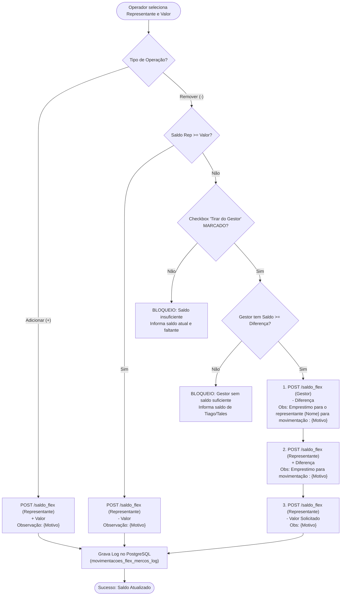

# Módulo de Movimentação de Verba Flex (Mercos)

**Identificador Único:** `MOD-MOVIMENTACAO-FLEX`  
**Arquivos de Código:**
- Frontend: `portal/modules/movimentacao-flex.php` e `portal/assets/js/movimentacao-flex.js`
- Backend: `v1/src/Controllers/FlexMovimentacaoController.php`
- Rotas API: `v1/routes/api.php` (`/v1/flex-movimentacao/...`)
- Banco de Dados: Tabela `movimentacoes_flex_mercos_log` e módulo em `sistema_modulos` (`slug = 'movimentacao-flex'`)
**Última Atualização:** 29/10/2026  
**Responsável Técnico:** Tech Lead & Arquiteto de Software

---

## 1. Objetivo do Módulo

O módulo **Movimentação de Verba Flex** foi desenvolvido para atender uma necessidade crítica e urgente da gestão comercial da Nutricional: **realizar movimentações manuais de crédito e débito no saldo Flex dos representantes diretamente na API Mercos**, com suporte a empréstimo coberto pelo Gestor da Filial, com auditoria completa no PostgreSQL e sem intervenção manual no ERP ou no painel da Mercos.

Principais objetivos:
1. **Consulta em Tempo Real:** Visualizar o saldo Flex atual do representante e do gestor da filial consultados diretamente na API Mercos (`/saldo_flex`).
2. **Adicionar Saldo (+):** Inserir crédito de saldo Flex na conta do representante com motivo/observação obrigatória.
3. **Remover Saldo (-):** Debitar saldo Flex do representante com validação estrita de suficiência.
4. **Empréstimo Automático do Gestor:** Quando o representante não possuir saldo suficiente (ou estiver zerado/negativo), uma opção de checkbox permite retirar a diferença necessária do saldo do Gestor da respectiva filial, registrando com precisão as três movimentações correlacionadas no histórico da Mercos.
5. **Auditoria e Rastreabilidade Completa:** Registro persistente de cada operação com IP, usuário logado, saldos anteriores/posteriores, ID do gestor, detalhes em JSON e status de execução.

---

## 2. Gestores por Filial e Arquitetura do Fluxo

### Identificação dos Gestores no Mercos:
* **Filial 1 (Matriz SC):**
  - ID Mercos do Colaborador: `12335`
  - Nome: `TIAGO (MOV)`
* **Filial 6 (Paraná PR):**
  - ID Mercos do Colaborador: `15816`
  - Nome: `TALES FERNANDO DE JESUS BINDE`

### Diagrama de Decisão e Fluxo de Execução



---

## 3. Regras de Negócio e Fórmulas de Cálculo

### Regra 1: Observação Obrigatória
Nenhuma movimentação de crédito ou débito pode ser processada com o campo de observação vazio. O sistema valida tanto no frontend (Alpine.js) quanto no backend (Slim 3 Controller), exigindo no mínimo 3 caracteres descritivos.

---

### Regra 2: Cálculo da Diferença a Retirar do Gestor

Quando a operação for de **Remover Saldo (-)** e a opção de cobertura do gestor for acionada:

$$\text{Diferença Necessária} = \begin{cases} 
\text{Valor Solicitado} - \text{Saldo Atual do Representante}, & \text{se Saldo Atual} > 0 \\
\text{Valor Solicitado}, & \text{se Saldo Atual} \le 0 
\end{cases}$$

#### Exemplo Prático 1: Representante com saldo parcial
- Saldo atual do Representante: **R$ 100,00**
- Valor solicitado de retirada: **R$ 120,00**
- Diferença calculada a retirar do Gestor: $\text{R\$} 120,00 - \text{R\$} 100,00 = \text{R\$} 20,00$.
- Movimentações geradas na Mercos:
  1. **Gestor:** Débito de **-R$ 20,00**  
     *Observação:* `Emprestimo para o representante JOAO DA SILVA para movimentação : Remoção para ajuste de saldo`
  2. **Representante:** Crédito de **+R$ 20,00**  
     *Observação:* `Emprestimo para movimentação : Remoção para ajuste de saldo`  
     *(Novo saldo temporário do representante passa a ser R$ 120,00)*
  3. **Representante:** Débito de **-R$ 120,00**  
     *Observação:* `Remoção para ajuste de saldo`  
     *(Saldo final do representante: R$ 0,00)*

#### Exemplo Prático 2: Representante zerado ou negativo
- Saldo atual do Representante: **R$ 0,00** (ou **-R$ 50,00**)
- Valor solicitado de retirada: **R$ 80,00**
- Diferença calculada a retirar do Gestor: **R$ 80,00** (integral).
- Movimentações geradas na Mercos:
  1. **Gestor:** Débito de **-R$ 80,00**
  2. **Representante:** Crédito de **+R$ 80,00**
  3. **Representante:** Débito de **-R$ 80,00**

---

### Regra 3: Tratamento de Falhas e Rollback de Compensação
Se qualquer chamada HTTP à API Mercos falhar durante o encadeamento de 3 etapas:
- Se a Etapa 1 (débito gestor) foi executada mas a Etapa 2 falhar, o backend realiza tentativa de estorno imediato no gestor.
- O erro é capturado, detalhado e gravado na tabela `movimentacoes_flex_mercos_log` com `sucesso = false` e o JSON da resposta da Mercos para auditoria imediata.

---

## 4. Estrutura do Banco de Dados

### Tabela de Auditoria: `movimentacoes_flex_mercos_log`

```sql
CREATE TABLE IF NOT EXISTS movimentacoes_flex_mercos_log (
    id SERIAL PRIMARY KEY,
    data_movimentacao TIMESTAMP NOT NULL DEFAULT CURRENT_TIMESTAMP,
    usuario VARCHAR(120) NOT NULL,
    filial INTEGER NOT NULL,
    idcolaborador VARCHAR(50) NOT NULL,
    nome_colaborador VARCHAR(180) NOT NULL,
    tipo_movimentacao VARCHAR(20) NOT NULL, -- 'credito' ou 'debito'
    valor_solicitado NUMERIC(15, 2) NOT NULL,
    observacao TEXT NOT NULL,
    saldo_anterior_rep NUMERIC(15, 2),
    saldo_novo_rep NUMERIC(15, 2),
    usou_gestor BOOLEAN DEFAULT FALSE,
    idgestor VARCHAR(50),
    nome_gestor VARCHAR(180),
    valor_gestor NUMERIC(15, 2) DEFAULT 0,
    saldo_anterior_gestor NUMERIC(15, 2),
    saldo_novo_gestor NUMERIC(15, 2),
    sucesso BOOLEAN DEFAULT TRUE,
    mensagem TEXT,
    detalhes_json JSONB
);

CREATE INDEX IF NOT EXISTS idx_mov_flex_rep ON movimentacoes_flex_mercos_log (idcolaborador);
CREATE INDEX IF NOT EXISTS idx_mov_flex_data ON movimentacoes_flex_mercos_log (data_movimentacao DESC);
```

---

## 5. Endpoints da API Slim 3

Base: `/v1/flex-movimentacao` (com autenticação via sessão e middleware `ModulePermissionMiddleware`)

| Método | Endpoint | Descrição |
| :--- | :--- | :--- |
| `GET` | `/v1/flex-movimentacao/contexto` | Permissões, filiais autorizadas e saldos ao vivo dos gestores (Tiago/Tales). |
| `GET` | `/v1/flex-movimentacao/representantes` | Lista representantes ativos no ERP e busca saldos na Mercos (`filial=1` ou `6`). |
| `GET` | `/v1/flex-movimentacao/saldo/{filial}/{idcolaborador}` | Saldo atualizado em tempo real do representante e do gestor da filial. |
| `GET` | `/v1/flex-movimentacao/historico` | Lista os últimos 100 registros de auditoria com filtros por filial e representante. |
| `POST` | `/v1/flex-movimentacao/movimentar` | Executa a movimentação (crédito direto, débito simples ou débito com cobertura do gestor). |

### Payload de Movimentação (`POST /movimentar`):
```json
{
  "filial": 1,
  "idcolaborador": "14820",
  "nome_colaborador": "REPRESENTANTE EXEMPLO",
  "tipo": "debito",
  "valor": 120.00,
  "observacao": "Remoção para ajuste de saldo",
  "usar_gestor": true
}
```

---

## 6. Manual de Usabilidade Passo a Passo

### Passo 1: Acessar o Módulo
1. No menu lateral do Portal, navegue até **Comercial** $\rightarrow$ **Movimentação Flex** (ou acesse a aba *"Movimentação Manual"* diretamente dentro dos módulos de Verbas Flex).
2. O sistema carrega os KPIs superiores:
   - **Saldo do Gestor da Filial Ativa** (Tiago MOV na Filial 1 ou Tales Binde na Filial 6).
   - **Total de Representantes da Unidade**.
   - **Saldo Consolidado da Equipe**.
   - **Última Movimentação Realizada**.

### Passo 2: Selecionar o Representante
1. Escolha a **Filial** (Matriz SC ou Paraná PR) no topo.
2. No campo **Representante Comercial**, pesquise pelo nome ou selecione na lista.
3. Ao selecionar, o card exibe imediatamente:
   - O saldo atual do representante consultado na API Mercos em tempo real.
   - O card do Gestor correspondente com o saldo disponível para eventuais empréstimos.

### Passo 3: Configurar a Operação
1. **Tipo de Movimentação:**
   - Clique em **Adicionar Saldo (+)** para conceder crédito.
   - Clique em **Remover Saldo (-)** para debitar verba.
2. **Valor:**
   - Digite o valor em Reais ou utilize os botões de atalho rápido (**+R$ 50**, **+R$ 100**, **+R$ 200**, **+R$ 500**).
3. **Observação (Obrigatória):**
   - Digite o motivo detalhado da movimentação (ex.: *"Ajuste acordado em reunião de metas"*, *"Estorno de verba de pedido cancelado"*, etc.).

### Passo 4: Cobertura do Gestor (Se Débito > Saldo)
1. Se o valor a remover for maior que o saldo do representante:
   - **Sem marcar o checkbox:** O botão de confirmação alertará que o saldo é insuficiente e bloqueará o envio.
   - **Marcando "Tirar saldo do gestor":** O sistema exibe uma **Caixa de Pré-visualização** demonstrando exatamente como serão lançadas as 3 movimentações no histórico da Mercos e o valor exato a ser debitado de Tiago/Tales.
2. Clique em **Confirmar Movimentação**. Uma janela SweetAlert2 solicitará a confirmação antes do envio final.

### Passo 5: Consulta e Auditoria
- Na aba **Histórico & Auditoria**, consulte todos os lançamentos realizados, contendo data/hora, usuário que executou, valores, se utilizou o gestor e os saldos antes e depois.

