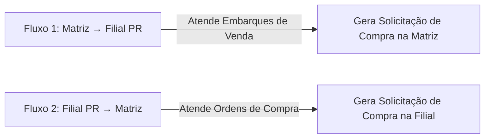
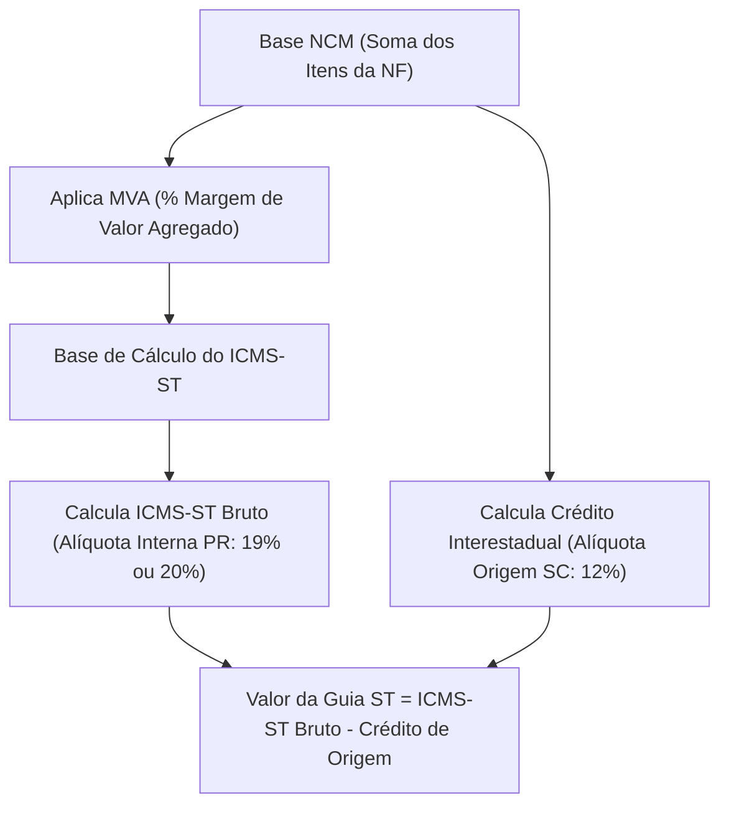

# Módulo de Transferência entre Unidades & Apuração de Guia ST

**Identificador Único:** `MOD-TRANSF-COMPRA`  
**Arquivos de Código:**
- Frontend: `portal/modules/transferencia-compra.php` e `portal/assets/js/transferencia-compra.js`
- Backend: `v1/src/Controllers/TransferenciaCompraController.php`
- Rotas API: `v1/routes/api.php` (`/v1/transf-compras/...`)
**Última Atualização:** 26/10/2026  
**Responsável Técnico:** Tech Lead & Arquiteto de Software

---

## 1. Objetivo do Módulo

O módulo **Transferência entre Unidades** tem como propósito automatizar e dar inteligência ao fluxo de transferência de mercadorias entre a **Matriz (Filial 1 - SC)** e a **Filial (Filial 6 - PR)**, com dois objetivos vitais para a distribuidora:

1. **Abastecimento Just-in-Time:** Calcular exatamente o que a Filial PR precisa receber para atender os embarques de pedidos de venda, abatendo o estoque que já existe no PR e blindando reservas de estoque.
2. **Conformidade Fiscal e Apuração de ICMS-ST:** Calcular previamente o valor exato da **Guia de ICMS-ST** devida ao Estado do Paraná para cada NCM, garantindo que o caminhão viaje com a guia paga ou gerada corretamente.

---

## 2. Dois Fluxos Operacionais

O módulo possui dois fluxos independentes acessíveis pelo seletor no topo:

### Fluxo 1: Matriz → Filial PR (`tipo=matriz-filial`)
- **Gatilho:** Embarques de pedidos criados no ERP/Portal destinados a clientes do Paraná.
- **Inteligência:** Analisa os pedidos do embarque, consulta o estoque atual no Paraná e calcula a necessidade líquida.
- **Resultado:** Insere a `solicitacao_compra` no ERP pronta para separação, faturamento e geração da NF de transferência.

### Fluxo 2: Filial PR → Matriz (`tipo=filial-matriz`)
- **Gatilho:** Ordens de Compra (OC) geradas pela Filial PR que demandam transferência de itens da Matriz.
- **Resultado:** Converte a OC pendente em solicitação de compra interna vinculada.

---

## 3. Regras de Negócio e Cálculos Detalhados

### Regra 1: Padrão Corporativo de Mês Corrente (Evita Números Exorbitantes)
* **Comportamento Padrão:** Ao abrir a tela, o sistema restringe os filtros de data (`dtIni` e `dtFim`) automaticamente para o **primeiro** e **último dia do mês corrente** (`01/MM/AAAA` a `31/MM/AAAA`).
* **Objetivo:** Evitar que os cards de KPI mostrem valores de anos acumulados (ex.: R$ 590 mil de guia ST ou R$ 1,4 milhão de ordens). O gestor visualiza exatamente o que está acontecendo no mês operacional atual.
* **Flexibilidade:** Caso deseje auditar períodos anteriores, basta alterar as datas nos campos e clicar em **Filtrar**.

---

### Regra 2: Proteção e Blindagem do Cliente #14523 (Reserva Filial PR)
* **Quem é o Cliente 14523?** É o código interno que representa a própria **Filial 6 (Depósito do Paraná)** atuando como cliente da Matriz.
* **Como Funciona:** Quando a diretoria cria um pedido para o cliente 14523 com 100 sacos de ração, a intenção é **estocar no Paraná como reserva** para pronta entrega, e não para atender um cliente final imediato.
* **Cálculo:** O sistema protege essa quantidade transferida para que ela abasteça o depósito de destino e não seja consumida indevidamente por rateios errôneos.

---

### Regra 3: Divisão Automática em Duas Solicitações (Remessa Marca 60 vs Venda Normal)
No ERP da Nutricional, amostras e brindes pertencem à **Marca 60 (Remessa)** e exigem transação contábil e fiscal diferente das rações normais.

Quando um embarque possui itens comuns e itens da Marca 60:
1. **Solicitação 1 (Remessa - Marca 60):**
   * Observação no ERP: `Remessa: {ID} - Placa: {PLACA}`
   * Tipo contábil: `tipo = 2`, `idcliforemp = 14523`
2. **Solicitação 2 (Normal - Demais Marcas):**
   * Observação no ERP: `Embarque: {ID} - Placa: {PLACA}`
   * Tipo contábil: `tipo = 1`

> Se o embarque contiver apenas rações normais, o sistema gera de forma atômica uma **única solicitação de compra**.

---

### Regra 4: Fórmula da Necessidade Líquida a Transferir

Para cada item presente nos pedidos do embarque:

$$\text{Necessidade a Transferir} = \max\Big(0,\; \sum \text{Qtd Pedidos} - \text{Estoque Físico na Filial 6}\Big)$$

* **Cenário A:** O embarque pede 50 unidades do Item X. A Filial 6 tem 20 unidades em estoque.
  $$\text{Transferir} = 50 - 20 = 30 \text{ unidades}$$
* **Cenário B:** O embarque pede 30 unidades do Item Y. A Filial 6 tem 45 unidades em estoque.
  $$\text{Transferir} = \max(0, 30 - 45) = 0 \text{ unidades (Atendido pelo estoque local)}$$

---

### Regra 5: Memória de Cálculo da Guia de ICMS-ST por NCM

O cálculo da Substituição Tributária (ST) para o Paraná utiliza as regras tributárias cadastradas na tabela `guia_transferencia_ncm_regra` para itens faturados na situação tributária `010`:

#### Fórmulas Matemáticas Oficiais:

1. **Base de Cálculo do ICMS-ST:**
   $$\text{Base ST} = \text{Base NCM} \times \left(1 + \frac{\text{MVA}\%}{100}\right)$$
   *(Exemplo: R\$ 27.102,33 com MVA de 59,60% = R\$ 43.255,32)*

2. **ICMS-ST Bruto (Débito de Destino no PR):**
   $$\text{ICMS-ST Bruto} = \text{Base ST} \times \left(\frac{\text{Alíquota Interna PR}\%}{100}\right)$$
   *(Exemplo: R\$ 43.255,32 × 19,5% = R\$ 8.434,79)*

3. **Crédito Interestadual (Origem SC):**
   $$\text{Crédito Origem} = \text{Base NCM} \times 12\%$$
   *(Exemplo: R\$ 27.102,33 × 12% = R\$ 3.252,28)*

4. **Valor Efetivo da Guia a Recolher:**
   $$\text{Valor da Guia} = \text{ICMS-ST Bruto} - \text{Crédito Origem}$$
   *(Exemplo: R\$ 8.434,79 - R\$ 3.252,28 = **R\$ 5.182,51**)*

---

## 4. Origem dos Dados (Tabelas do ERP PostgreSQL)

| Informação | Tabela de Origem | Chaves / Relacionamentos |
| :--- | :--- | :--- |
| **Embarques Pendentes** | `vw_pex_embarque`, `embarque_pedido` | `idembarque`, `filial = 6` |
| **Pedidos do Embarque** | `embarque_pedido_item`, `pedido`, `cliforemp` | `idpedido`, `idcliforemp` |
| **Itens e Saldo** | `pedido_item`, `item`, `estoque` | `iditem`, `iddeposito = 6` |
| **Solicitações Criadas** | `solicitacao_compra` | `idsolicitacaocompra`, `idfilial = 1` |
| **Itens da Solicitação** | `solicitacao_compra_item` | `idsolicitacaocompra`, `iditem` |
| **Notas Fiscais de Transferência** | `nfs`, `nfs_item` | `idnfs`, `ni.idsolicitacaocompra = sc.idsolicitacaocompra` |
| **Regras Fiscais NCM / MVA** | `guia_transferencia_ncm_regra` | `ncm`, `st_pr = true`, `vigencia_inicio` |

---

## 5. Manual para Estudo & Perguntas Frequentes (FAQ)

### P1: "Por que as solicitações aparecem com badge amarelo 'Pendente NF'?"
**Resposta:** Assim que o encarregado clica em "Gerar Solicitação no ERP", a necessidade de compra é criada no banco. Porém, o caminhão só pode carregar após a Matriz emitir a Nota Fiscal de Transferência. O badge amarelo indica que a solicitação existe, mas a NF ainda não foi faturada. Quando a NF é faturada no ERP, o status muda para verde `Faturada (NF #XXXXX)` e o valor da Guia ST é calculado em cima da nota emitida.

### P2: "O que acontece se um embarque já teve solicitação gerada anteriormente?"
**Resposta:** O sistema possui proteção contra duplicidade. A API verifica via regex se já existe solicitação com `Embarque: {ID}` ou `Remessa: {ID}` ativa (status diferente de 3/Cancelada). Caso exista, a API bloqueia a geração e avisa o usuário, impedindo compras ou transferências duplicadas.

### P3: "Por que o valor da Guia ST não bate simplesmente aplicando a alíquota no valor total da nota?"
**Resposta:** Porque a legislação do Paraná exige a aplicação da **MVA (Margem de Valor Agregado)** por NCM, e permite o abatimento do **crédito interestadual de 12%** que a Matriz destacou em Santa Catarina. O cálculo é feito item a item, agrupado por NCM, garantindo precisão contábil total com a SEFAZ-PR.

---

## 6. Histórico de Alterações & Manutenções (Changelog)

| Data | Versão | Autor | Descrição da Manutenção |
| :--- | :--- | :--- | :--- |
| **26/10/2026** | v2.2 | Tech Lead | **Filtro Mês Corrente Padrão:** Pré-carregamento automático de `dtIni` e `dtFim` no mês atual no frontend e backend para evitar números exorbitantes. |
| **23/10/2026** | v2.1 | Tech Lead | **Exibição Pré-NF & Detalhes:** Solicitações passam a aparecer antes de faturar com status pendente e modal com pesos, embarque, pedidos e itens. |
| **23/10/2026** | v2.0 | Tech Lead | **Separação de Remessa (Marca 60):** Divisão automática em duas solicitações quando há itens de amostra/brinde. |
| **20/10/2026** | v1.0 | Tech Lead | **Lançamento do Módulo:** Cálculo de necessidade com dedução de estoque local e memória fiscal de Guia ST. |

